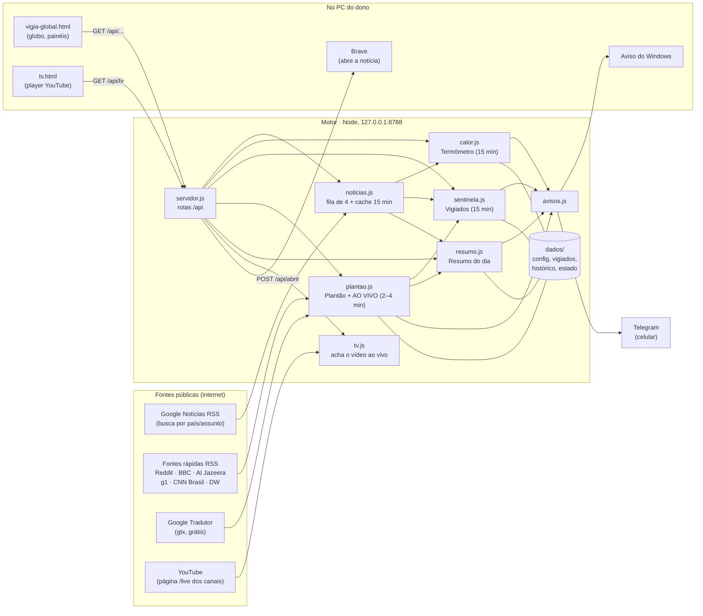

# Vigia Global: documento de handoff

Este documento é para **quem vai continuar o projeto**: uma pessoa programadora ou o Claude Code. Ele explica para que o Vigia serve, como funciona por dentro, onde está cada coisa, quais regras não podem ser quebradas e o que falta fazer.

> **Situação em 12/11/2026:** funcionando no PC do dono, ligado junto com o Windows. As fases 1 e 2 do plano [`melhorias-portal.md`](melhorias-portal.md) e a TV ao vivo estão prontas. A Fase 3 espera a aprovação do dono.

---

## 1. Em 30 segundos

- **O que é:** um portal de notícias do mundo em forma de globo 3D. Funciona como um app de Windows, mas por dentro é uma página web servida por um motor Node local.
- **Para quem:** o dono, que não é programador. Explique sempre **o que muda para ele**, em português simples, e não o código.
- **Sem IA e sem chave de API:** tudo vem de RSS público. O Claude só entra quando o dono pede mudanças.
- **Sem dependências:** só Node puro (`http`, `fs`, `fetch` nativo) e um único HTML com canvas. Não há `npm install`. **Não adicione bibliotecas.**
- **Duas partes:**
  1. **Motor** (`servidor.js` + `motor/*`), em Node, escondido, em `127.0.0.1:8788`. Ele busca, mede, vigia e avisa.
  2. **Janela** (`vigia-global.html`, uns 200 KB), aberta numa janela `--app` do Edge. A **TV** (`tv.html`) abre em outra janela.

## 2. Arquitetura

**Como ele liga:**
- `abrir.js` confere `/api/saude`. Se o motor não responde, liga o `servidor.js` destacado, com o log em `dados/motor.log`, e espera ele subir.
- Depois abre o Edge com `--app=http://localhost:8788`, perfil próprio em `%LOCALAPPDATA%\VigiaGlobal\janela-edge`, a RTX forçada e um Edge enxuto.
- Com `--sem-janela`, só liga o motor. É assim que o atalho da inicialização do Windows chama.

## 3. Mapa dos arquivos

| Arquivo | Para que serve |
|---|---|
| `servidor.js` | Servidor http e rotas da API (seção 5). Serve só os arquivos da lista `PUBLICOS` e os `estados/XX.json`. |
| `abrir.js` | Liga o motor e abre a janela (veja acima). |
| `vigia-global.html` | **Toda a interface** num arquivo: canvas do globo, CSS e JS. |
| `tv.html` | Janela da TV ao vivo (`/tv`). |
| `motor/noticias.js` | Google Notícias RSS em pt-BR: `buscaUrl`, `lerFeed`, fila (`naFila`, 4 ao mesmo tempo), cache de 15 min, as 15 `CATEGORIAS`, `buscar`, `buscarEstado` e `linkSeguro` (lista dos links que podem ser abertos). |
| `motor/paises-texto.js` | `paisesNoTexto(titulo)`: países citados (nome, apelido, gentílico, capital), em ordem de posição. `ehFora(titulo)`: filtro de lixo (esporte, novela, loteria…). |
| `motor/paises.json` | Os 175 países (código → nome). |
| `motor/calor.js` | **Termômetro:** 16 buscas mundiais a cada 15 min, contagem por país e histórico de 100 leituras. `esquentou(cod)` e `maisAquecidos()`. Se a medição falha, tenta de novo em 30 s, 1 min, 2 min e depois a cada 5 min. |
| `motor/sentinela.js` | **Vigiados:** confere os países e palavras do dono a cada 15 min (pode ser 10, 30 ou 60). Na 1ª vez de cada vigiado só "semeia", sem avisar. Só avisa notícia de até 6 h. Também recebe na hora o que chega pelo Plantão (`doPlantao`). |
| `motor/plantao.js` | **Plantão:** 8 fontes rápidas a cada 2–4 min, com ETag, recuo em 429 e tradução. Agrupa as notícias da mesma história numa janela de 3 h. Com 3 ou mais fontes e urgência, vira plantão. Alimenta a faixa e o AO VIVO de 12 h (`fontes`, `grupo`, `vistoEm`). |
| `motor/fontes-pais.js` | O país de cada veículo, para o "visto em". **Sem certeza, fica sem país.** |
| `motor/traduzir.js` | Traduz as manchetes em inglês (Google `client=gtx`), no máximo 60 a cada 10 min, com cache. |
| `motor/resumo.js` | **Resumo do dia:** 10 histórias do Mundo e 5 do Brasil. Manda no Telegram 1 vez por dia, no horário escolhido. |
| `motor/avisos.js` | Toast do Windows (PowerShell, AUMID `VigiaGlobal`; o clique abre o link) e Telegram (`sendMessage`). |
| `motor/brave.js` + `trazer-brave.cs` | Abre o link no Brave e traz a janela dele para a frente. O `.exe` é compilado sozinho no 1º uso pelo `csc.exe` do .NET Framework do Windows (não vai para o git). |
| `motor/tv.js` | **TV ao vivo:** `LISTA` com 35 países e 68 canais (id `UC…` fixo). `aoVivo(id)` lê `youtube.com/channel/<id>/live` e devolve `videoId`, título, quantos assistem e se toca fora do YouTube. Cache de 10 min (2 min se estava fora do ar). |
| `estados/XX.json` | Contornos dos estados de 175 países (Natural Earth, domínio público, 3,9 MB). |
| `ferramentas/reiniciar-motor.js` | Para o motor, liga de novo e confere `/api/saude`. |
| `ferramentas/conferir-tv.js` | Confere se as 68 emissoras estão no ar e tocam fora do YouTube. |
| `ferramentas/converter-estados.js` | Gera os `estados/*.json` de novo a partir do Natural Earth. |
| `config.exemplo.json` | Modelo do `dados/config.json`. |
| `CLAUDE.md` | Contexto completo para o Claude Code: regras, medições de desempenho e linha do tempo. **Leia junto com este arquivo.** |
| `melhorias-portal.md` | O plano em 4 fases, com as regras de cada uma. |

**Fora do git** (veja o `.gitignore`): `dados/`, que tem os segredos e o estado; `versoes/`, com os backups locais; e `motor/trazer-brave.exe`.

## 4. Os ciclos do motor (o que roda sozinho)

| Quem | Quando | O que faz |
|---|---|---|
| Termômetro (`calor.js`) | 3 s depois de ligar, depois a cada 15 min | 15 buscas por assunto + seção Mundo, conta os países e grava em `dados/calor-*.json` |
| Vigiados (`sentinela.js`) | 1 min depois de ligar, depois a cada N min (padrão 15) | Busca cada palavra e país (com termos urgentes) e avisa o que é novo |
| Plantão (`plantao.js`) | Confere a cada 30 s quais fontes já "venceram" (2–4 min cada) | Lê as fontes, traduz, agrupa e decide se é plantão. Repassa o que chegou para os Vigiados |
| Resumo (`resumo.js`) | Monta 90 s depois de ligar e confere o horário a cada 1 min | Manda no Telegram no horário (até 6 h depois, se o PC ligou tarde) |
| TV (`tv.js`) | **Só quando alguém escolhe uma emissora** | Lê a página `/live` do canal. Parado, não gasta nada |

O motor ocupa de 45 a 82 MB de RAM e quase 0% de CPU.

## 5. Rotas da API

Todas ficam em `http://127.0.0.1:8788`. Os `POST` só aceitam `Origin` do próprio Vigia e `Content-Type: application/json`.

| Rota | O que devolve ou faz |
|---|---|
| `GET /api/saude` | `{ok, app, assuntos, brave}` |
| `GET /api/noticias?p=JP&cats=economia,tecnologia[&e=Estado]` | Manchetes do país ou do estado, por assunto (o estado precisa existir no mapa) |
| `GET /api/calor` | Termômetro: `{em, paises: {US: {total, cats, top}}, max, falhas}` |
| `GET /api/plantao?p=&e=` | Faixa, plantões e estado das fontes rápidas (filtrado por país ou estado) |
| `GET /api/aovivo` | Lista AO VIVO das últimas 12 h |
| `GET /api/resumo` · `POST /api/resumo/enviar` | Resumo do dia · manda agora no Telegram |
| `GET`/`POST /api/vigiados` · `POST /api/vigiados/testar` | Lê e grava os vigiados · manda um aviso de teste |
| `POST /api/abrir` `{link}` | Abre no Brave. Só aceita links que passam por `linkSeguro` (manchetes conhecidas e `youtube.com/watch?v=<id>`) |
| `GET /api/tv` · `GET /api/tv/aovivo?c=<UC…>[&denovo=1]` | Lista de emissoras · o vídeo ao vivo de um canal (só canais da lista) |
| `/`, `/tv`, `/estados/XX.json`, ícones | Arquivos públicos. Qualquer outro caminho devolve 404 |

## 6. A janela (`vigia-global.html`)

- **Globo:** projeção ortográfica com ~10.700 pontos em canvas, desenhados em "baldes" por profundidade, luz (dia e noite) e calor (`BALDES`). Tem chuva Matrix, varredura e viagem automática entre países.
- **Quadros por segundo controlados:** 30 em uso, 12 com outro programa na frente, 60 arrastando e 0 minimizado. No modo leve, 20 e 6. Os efeitos de DOM andam no mesmo relógio do globo (`efeito()` / `rodarEfeitos()` / `animacoesPequenas`).
- **Fase 1 (portal ao vivo):** ping de notícia nova (`/api/aovivo`), marca `[JP]` na borda, etiqueta de alvo, plantão com câmera (`girarAte`) e teletipo, selo de tempo (`selo()`), cartão "enquanto você estava fora" e separadores de hora no AO VIVO.
- **Fase 2 (credibilidade):** "visto em" (`vistoEmEl`), dia e noite (`calcularLuz`, `posicaoDoSol`), hora local com a capital (`CAPITAL`, `horaLocal`), relógios no topo, ajuda `?` e **arcos entre países (prontos, mas desligados)**.
- **Mergulho:** ao clicar num país, carrega `estados/XX.json`, desenha os estados com efeito de radar e busca as notícias do estado.
- **TV:** `abrirTV(cod)` reaproveita a janela `vigia-tv` (`window.open('', 'vigia-tv', …)`). Se ela já está aberta, só troca o `#BR`.
- **O que fica salvo no navegador** (`localStorage`): `vigia.leve`, `vigia.som`, `vigia.filtro`, `vigia.calor`, `vigia.arcos`, `vigia.relogios`, `vigia.tv`, `vigia.ultimaVisita`, `vigia.vistoAte`, `vigia.plantoes`, `vigia.resumoVisto`, `vigia.aovivoAba` e `vigia.aovivoVisto`.

### TV ao vivo (`tv.html` + `motor/tv.js`)

- O jeito antigo de embutir "o ao vivo de um canal" (`embed/live_stream?channel=`) **dá erro 150 desde 2025**. Por isso o motor lê a página `/live` do canal, tira o `videoId` de `ytInitialPlayerResponse` e a janela embute `youtube-nocookie.com/embed/<videoId>`.
- A página fala com o player por `postMessage` (`listening`, `mute`/`unMute`, `infoDelivery`, `onError`), sem a biblioteca do YouTube.
- O navegador só deixa tocar com som depois de um clique. Por isso a TV começa muda, com o botão "🔊 Ligar o som".
- **Ficaram de fora:** Globo e GloboNews (só Globoplay, com login), RT e Rossiya 24 (saíram do YouTube), Sky TG24 (bloqueada no Brasil) e alguns países sem ao vivo aberto. No Brasil, o padrão é a CNN Brasil.
- **Manutenção:** canais mudam. Rode `node ferramentas/conferir-tv.js`. Para trocar um canal, edite a `LISTA` em `motor/tv.js`, usando o id `UC…` e não o @nome.

## 7. A pasta `dados/` (não vai para o git)

Ela é criada sozinha. Num PC novo, só o `config.json` precisa ser feito à mão, e só se quiser o Telegram.

| Arquivo | Conteúdo | Segredo? |
|---|---|---|
| `config.json` | `{telegram: {token, chatId}, gpuDedicada}` | **SIM.** Nunca mostre, imprima nem mande para a janela |
| `vigiados.json` | Países, palavras, avisos, intervalo, plantão e resumo do dono | Pessoal |
| `vistos.json` / `achados.json` | O que os Vigiados já viram e os avisos já dados | Não |
| `calor-historico.json` / `calor-atual.json` | Leituras do termômetro e a última medição | Não |
| `plantao.json` / `resumo.json` | Estado do Plantão e do Resumo | Não |
| `motor.log` | Saída do motor | Não |

## 8. Regras que não podem ser quebradas

1. **Segurança:**
   - O token e o chatId do Telegram ficam **só** em `dados/config.json`: nunca no código, na janela, em log ou no git.
   - Mensagem no Telegram, inclusive de teste, **só com o OK do dono**.
   - Pergunte antes de baixar arquivos e antes de mexer em inicialização, registro ou atalhos do Windows.
2. **Desempenho:**
   - Nada de animação CSS infinita e nada de `backdrop-filter`: eles forçavam a tela a ser recomposta 60 vezes por segundo.
   - Tudo anima pelo relógio do globo, e **parado não gasta nada**.
   - Meta: o globo em uso custa no máximo ~5% de CPU e ~+2,3 W na RTX.
   - Meça antes e depois. As tabelas estão no `CLAUDE.md`.
3. **Cores com significado:**

   | Cor | Significado |
   |---|---|
   | Vermelho | **Só plantão** |
   | Verde | Notícia comum |
   | Âmbar | Vigiado |
   | Ciano | Natureza (Fase 3) |

4. **Teclas:** confira se a tecla está livre antes de usar. `H` está reservada para o replay (Fase 3) e `F` para o modo TV (Fase 4).
5. **Plano:** uma fase de `melhorias-portal.md` por vez, e só com a aprovação do dono.
6. **Backup:** antes de uma mudança grande, copie os arquivos para `versoes/arquivo-AAAA-MM-DD-antes-do-X.ext`. Com o git, um commit antes também serve.
7. **Edição do HTML grande:** leia o trecho antes e edite com uma ferramenta de edição exata. `sed`, heredoc e `node -e` já comeram barras invertidas de regex.
8. **Filtros de texto:** cuidado com duplo sentido. "rodada de negociações" e "jogo político" não são esporte, e "ao vivo" puxava futebol.
9. **Idioma:** tudo em português do Brasil: a interface, os comentários e as respostas ao dono.

## 9. Como testar

- **Motor:** `node ferramentas/reiniciar-motor.js`. Depois abra `http://127.0.0.1:8788/api/saude` e as outras rotas. O log fica em `dados/motor.log`.
- **Janela:** o que funcionou foi uma **cópia do Edge fora da tela**, com perfil próprio e comandada por CDP:
  - Abra com `--window-position=-2600,40 --user-data-dir=<perfil temporário> --remote-debugging-port=9333 --disable-features=CalculateNativeWinOcclusion`.
  - Comande com `Runtime.evaluate` e `Page.captureScreenshot`. O Node 26 já tem `WebSocket`.
  - Use `#foco` na URL para medir como "em uso" e `#foco-leve` para o modo leve.
  - Apague o perfil depois.
  - O painel de navegador embutido do app Claude falha quando está escondido.
- **TV:** `node ferramentas/conferir-tv.js` (68/68 em 09/11/2026). Nos testes automáticos, substitua o `window.open` para não abrir uma janela de verdade.
- **Desempenho:** CPU e placa 3D por processo (contador `\GPU Engine(*engtype_3D)\Utilization Percentage`, filtrado pelos PIDs do Edge), mais `nvidia-smi --query-gpu=power.draw`.

## 10. Estado atual e próximos passos

**Pronto:**
- globo;
- notícias por país e estado, com 15 assuntos;
- Termômetro, Vigiados, Plantão, AO VIVO e Resumo do dia;
- avisos do Windows e do Telegram;
- modo leve;
- Fase 1 e Fase 2 do plano;
- TV ao vivo (68 emissoras);
- recuperação depois de ligar o PC sem internet.

**Esperando o dono:**
- **Ligar os arcos entre países** (`vigia.arcos`, hoje desligados). Se ele aprovar, tirar os arcos decorativos aleatórios (`novoArco`), que podem ser confundidos com os de verdade.
- **Fase 3:** replay das últimas 24 h (tecla `H`), terremotos e alertas (USGS / GDACS, em ciano) e "seguir uma história".
- **Fase 4** (opcional): visão de dentro, modo TV (tecla `F`) e fotos em verde.

**Ideias guardadas** (oferecer só se o dono pedir): "onde o mundo fala de X", ficha do país, a mesma história em várias fontes lado a lado e salvar para ler depois. Mercado (dólar, bolsa, cripto) é assunto de outro projeto do dono e ficou de fora de propósito.

## 11. Armadilhas já conhecidas

| Problema | O que fazer |
|---|---|
| O PC liga e o motor sobe antes do Wi-Fi | Já resolvido: termômetro e vigiados tentam de novo logo, e a última medição volta do disco. |
| Reddit devolve 429 | O Plantão espera mais (até 20 min) para aquela fonte. Não diminua os intervalos. |
| O Google Tradutor limita | No máximo 60 traduções a cada 10 min, com cache. |
| Emissora some ou para de deixar embutir | `conferir-tv.js` e trocar na `LISTA`. Erro 150/101 = o canal não deixa tocar fora do YouTube. |
| O YouTube nem sempre manda quantos assistem | A janela só esconde o número. |
| Reiniciar o motor | Apaga da memória o Plantão e o AO VIVO. Eles voltam em 1 a 2 minutos. |
| O tradutor escreve em português de Portugal ("Irão", "Benim") | Já está em `paises-texto.js`. Ao ver outro caso, acrescente lá. |

---

*Mantenha este arquivo, o `README.md` e o `CLAUDE.md` atualizados a cada mudança, com data, na linha do tempo do `CLAUDE.md`.*
